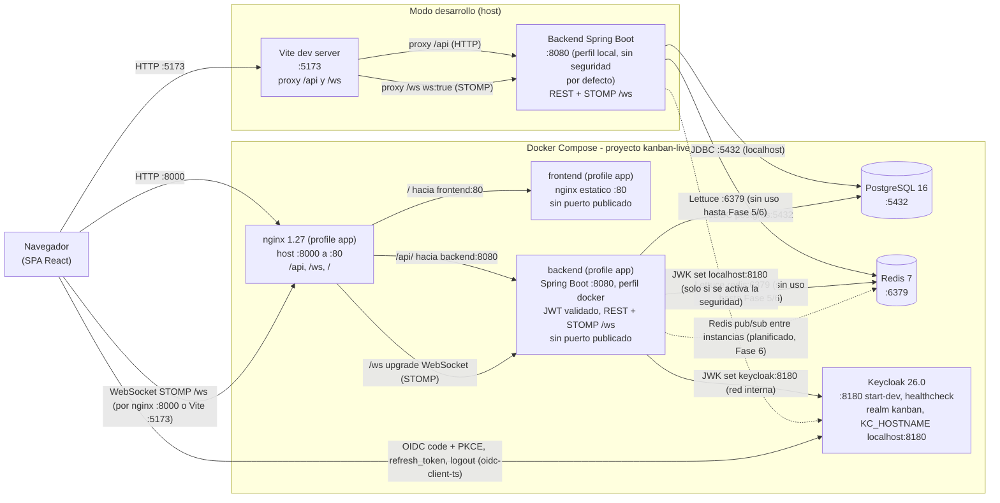
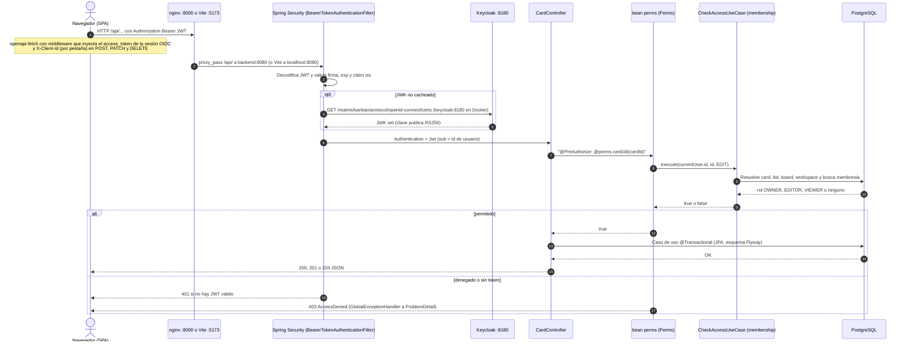
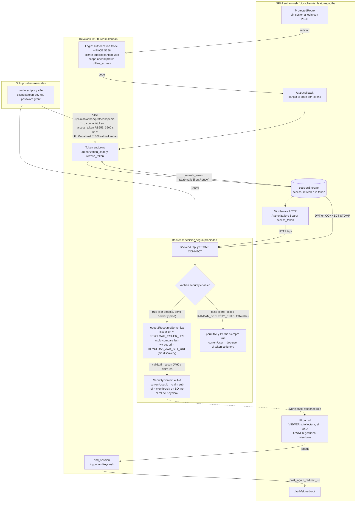
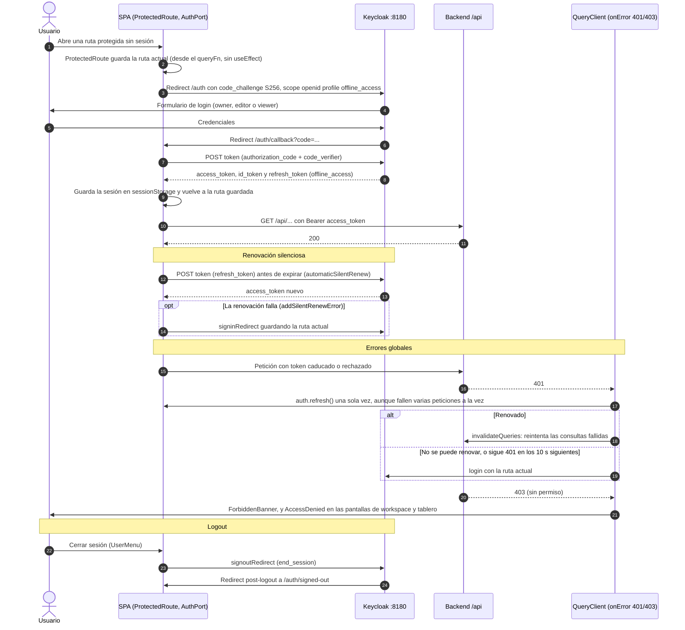
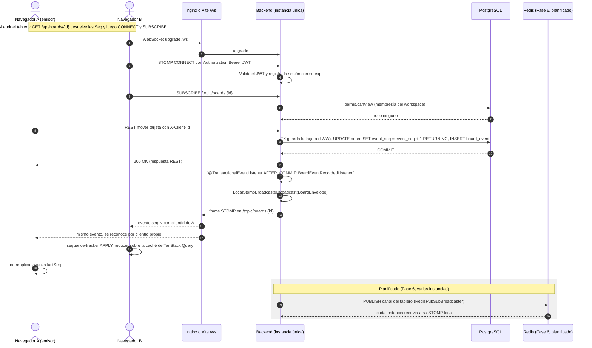
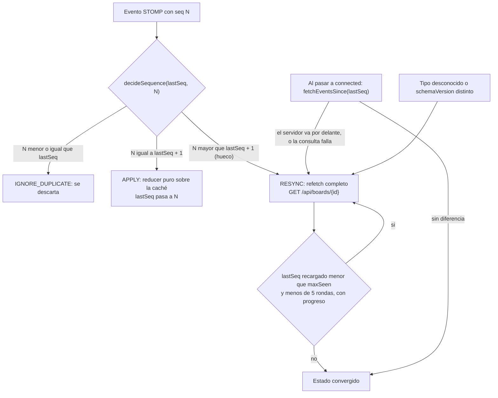
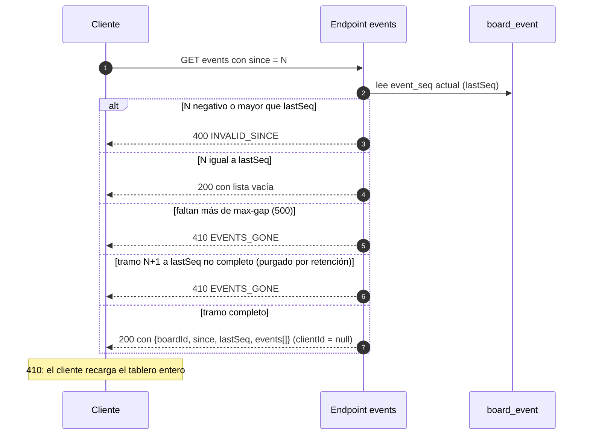
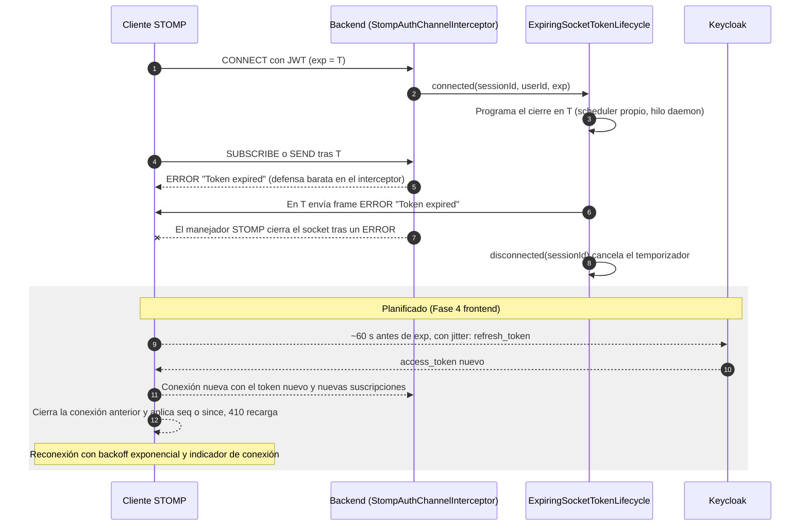
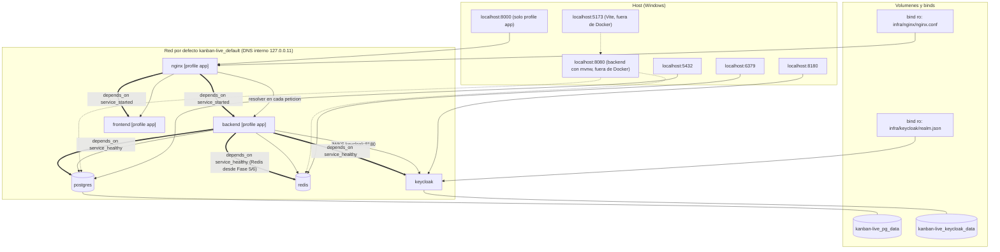

# Diagrama de infraestructura y comunicación de Kanban Live

Documento generado a partir de lo que **existe hoy** en el repo (`infra/docker-compose.yml`, `infra/nginx/nginx.conf`, `infra/keycloak/realm.json`, `backend/src/main/resources/application*.yml`, `SecurityConfig`, `Perms`, `frontend/vite.config.ts`, cliente HTTP del frontend, Dockerfiles, `initial-plan.md` sección 11, los ADR 0004-0010 de `docs/adr`, `docs/contracts/board-events.md`, el backend de tiempo real (`platform/messaging`, `platform/scheduling`, `collaboration`, `boards/adapter/in/job`), `membership`/`workspaces`, el frontend (`features/auth`, `features/realtime`, `app/providers`) y `frontend/e2e`). Actualizado tras las Fases 2 (auth), 3 (tiempo real) y 4 backend (conflictos y reconexión); la Fase 4 frontend sigue planificada.

Leyenda: las líneas continuas y los nodos normales están **implementados**; las líneas discontinuas y lo marcado *(planificado)* **no existen aún** en el código.

## 1. Vista general de componentes

Dos modos de acceso: **desarrollo** (Vite en 5173 con proxy `/api` y `/ws` al backend en 8080 con perfil `local`, infra en Docker) y **stack completo** (`--profile app`: backend con perfil `docker`, todo detrás de nginx en el puerto 8000 del host).

Notas:
- **STOMP ya existe** (Fase 3): `platform/messaging` (`WebSocketConfig`, `StompAuthChannelInterceptor`, `ExpiringSocketTokenLifecycle`) y `collaboration` (`LocalStompBroadcaster`, `BoardEventRecordedListener`, `BoardEventsController`) tienen código; el broker es el **simple en memoria** de cada instancia (`/topic`).
- **Redis sigue sin uso**: `redis` está en compose y `spring-boot-starter-data-redis` en el `pom.xml`, pero `collaboration/adapter/out/redis` y `presence/adapter/out/redis` solo contienen `package-info.java`. El pub/sub entre instancias (Fase 6) y la presencia (Fase 5) están planificados; por eso la línea backend a Redis es de Lettuce sin tráfico y la de pub/sub es discontinua.
- Vite (con `ws: true`) y nginx proxean `/ws` al endpoint STOMP del backend. El navegador habla WebSocket siempre con el mismo origen que sirve la SPA (la línea `Browser a Nginx` representa también `Browser a Vite` en desarrollo).
- El navegador habla con Keycloak (`:8180`) directamente para el login OIDC y la renovación del token (flujo en la sección 3); no pasa por nginx ni por Vite.
- `postgres`, `redis` y `keycloak` arrancan siempre; `backend`, `frontend` y `nginx` solo con `docker compose --profile app up`.
- CORS no es necesario para REST: la SPA siempre llama al mismo origen (proxy de Vite o nginx). Para el handshake WebSocket, `WebSocketConfig` aplica `setAllowedOriginPatterns` con `kanban.ws.allowed-origin-patterns`, que **no está definida en ningún `application*.yml`** y por tanto vale `*` (cualquier origen); la defensa real es el JWT en `CONNECT` (ver sección 6).

## 2. Flujo de petición REST

Ejemplo con una operación sobre una tarjeta (`@PreAuthorize("@perms.canEdit(#cardId)")` en `CardController`), con seguridad activa (`kanban.security.enabled=true`: valor por defecto, y también en el perfil `docker`).

Cada escritura de tablero, lista o tarjeta ejecuta además, **dentro de la misma transacción**, `RecordBoardChangeService` (asigna `seq` y guarda `board_event`) y publica el evento de dominio que se difunde por STOMP tras el commit (flujo completo en la sección 4). El `PATCH` de edición lleva `version` y responde `409 STALE_VERSION` con la propiedad `current` si está obsoleta; mover tarjeta o lista es *last-write-wins* y nunca da 409 (ADR-0005).

Endpoints añadidos desde la Fase 2 y la Fase 4 (con `@PreAuthorize` salvo el listado de workspaces, que filtra por membresía en el caso de uso):

| Endpoint | Permiso | Notas |
|---|---|---|
| `GET /api/workspaces` | sin `@PreAuthorize` (JWT válido) | El caso de uso filtra: devuelve solo los workspaces donde el usuario es miembro (todos como OWNER con la seguridad desactivada). `WorkspaceResponse` incluye `role` (`OWNER`, `EDITOR` o `VIEWER`) del usuario actual; la UI lo usa para mostrar u ocultar controles. El rol de un tablero es el de su workspace |
| `GET /api/workspaces/{id}` | `canView` (cualquier miembro: OWNER, EDITOR o VIEWER) | Mismo `WorkspaceResponse` con `role` |
| `GET /api/workspaces/{id}/members` | `canAdmin` (OWNER) | Expone ids de usuario: solo OWNER |
| `DELETE /api/workspaces/{id}/members/{userId}` | `canAdmin` (OWNER) | `LAST_OWNER` si es el último OWNER |
| `POST` / `PATCH /api/workspaces/{id}/members[/{userId}]` | `canAdmin` (OWNER) | Invitar por `sub` de Keycloak / cambiar rol |
| `GET /api/boards/{id}` | `canView` | Incluye `lastSeq` (lectura en una única instantánea REPEATABLE_READ junto a listas y tarjetas) |
| `GET /api/boards/{id}/events?since=N` | `canView` | Eventos con `seq > since` para resincronizar. `410 EVENTS_GONE` si faltan más de `kanban.events.max-gap` (500) o el tramo fue purgado; `400 INVALID_SINCE` si `since` es negativo o mayor que el `seq` actual |

Rutas públicas incluso con seguridad activa: `/actuator/health/**`, `/actuator/info`, `/v3/api-docs/**`, `/swagger-ui/**` (Swagger solo existe con springdoc habilitado: perfiles `local`, `docker` y `test`). Todo lo demás exige JWT. CSRF está deshabilitado.

Perfil `local` (`kanban.security.enabled=false`): se usa la cadena `openSecurityFilterChain` (`anyRequest().permitAll()`), `Perms` devuelve siempre `true` y `SecurityContextCurrentUser` devuelve `kanban.security.dev-user-id` (por defecto `dev-user`). No hay llamada a Keycloak ni comprobación de membresía. En el perfil `docker` se puede abrir igual con `KANBAN_SECURITY_ENABLED=false`.

## 3. Flujo de autenticación

Estado: **implementado** (Fase 2 backend y frontend, ADR-0009). Ya no hay token de desarrollo en el frontend (`VITE_DEV_TOKEN` eliminado): la SPA hace login OIDC real contra Keycloak.

Secuencia del login (Authorization Code + PKCE), la renovación silenciosa y el manejo global de 401/403:

Detalles del realm `kanban` (`infra/keycloak/realm.json`, importado con `--import-realm`, `sslRequired: none`):
- Clientes: `kanban-web` (público, standard flow + PKCE S256; `rootUrl` `http://localhost:5173`; `redirectUris` y `post.logout.redirect.uris` `http://localhost:5173/*` y `http://localhost:8000/*`; `webOrigins` `http://localhost:5173` y `http://localhost:8000`), `kanban-dev-cli` (público, **solo** password grant para curl, pruebas manuales y el seed de Playwright), `kanban-api` (bearer-only, resource server).
- Usuarios de desarrollo: `owner/owner`, `editor/editor`, `viewer/viewer` con roles de realm `owner|editor|viewer` **y `offline_access`** (necesario para que Keycloak entregue `refresh_token`; sin él el login falla con `not_allowed`). Los roles `owner|editor|viewer` del realm **no** autorizan nada: la autorización real es la membresía por workspace en BD, y el rol se entrega a la UI en `WorkspaceResponse.role`.
- Issuer vs JWKS: con `KC_HOSTNAME=http://localhost:8180` y `KC_HOSTNAME_BACKCHANNEL_DYNAMIC=true`, todos los tokens llevan `iss=http://localhost:8180/realms/kanban` aunque se pidan por otro host. El backend en Docker compara contra ese issuer (`KEYCLOAK_ISSUER_URI`) y descarga el JWKS por la red interna (`KEYCLOAK_JWK_SET_URI=http://keycloak:8180/...`). Al definir `jwk-set-uri` no hay discovery del issuer en el arranque.
- Los cambios de `realm.json` solo se aplican al reimportar: con el volumen de una versión anterior del realm los usuarios **no tienen `offline_access`** y el login falla. Hay que recrear el volumen (`docker volume rm kanban-live_keycloak_data` con keycloak parado y volver a levantarlo) o arrancar un proyecto compose nuevo (`docker compose -p kanban-live-e2e up -d keycloak`).
- El access token dura 3600 s (`accessTokenLifespan`). El mismo JWT autentica el `CONNECT` STOMP (sección 4).

## 4. Flujo en tiempo real / eventos

**Estado: implementado para una instancia** (Fase 3, y la parte de backend de la Fase 4; ADR-0005, 0006, 0008, 0010 y `docs/contracts/board-events.md`). **Planificado**: reconexión con backoff, renovación del JWT en el socket, indicador de conexión y reaplicar el log tras reconectar (Fase 4 frontend); presencia sobre Redis (Fase 5) y pub/sub entre instancias (Fase 6).

Piezas implementadas:
- Backend: endpoint STOMP `/ws` con broker simple en `/topic` y prefijo `/app` (`WebSocketConfig`). `StompAuthChannelInterceptor` autentica el JWT en el `CONNECT` (cabecera STOMP `Authorization`, no en el upgrade HTTP), autoriza `SUBSCRIBE` solo a `/topic/boards.{id}` con el mismo chequeo que `canView`, limita `SEND` a `/app/**` y deniega todo lo demás. `RecordBoardChangeService` (`@Transactional(MANDATORY)`) reserva el `seq` del tablero e inserta `board_event` dentro de la transacción del caso de uso y publica `BoardEventRecorded`; `BoardEventRecordedListener` (`@TransactionalEventListener(AFTER_COMMIT)`) lo entrega a `LocalStompBroadcaster`, que envía el `BoardEnvelope` a `/topic/boards.{id}`. Un fallo de difusión se registra y no rompe la petición.
- Frontend: `StompBoardEvents` (una conexión compartida, una suscripción por tablero), `sequence-tracker` (`APPLY`, `IGNORE_DUPLICATE`, `RESYNC`), `createBoardSyncSession` + `useBoardSync` (store externo con `useSyncExternalStore`, sin `useEffect`) y `RealtimeProvider`, montado en `BoardPage` cuando el tablero ya está en caché.
- Envelope: `{boardId, seq, type, payload, clientId, occurredAt, schemaVersion}`. `clientId` sale de la cabecera `X-Client-Id` de la petición REST original, de modo que el emisor reconoce su propio eco: no lo reaplica pero sí avanza `lastSeq`.

Reglas del plan que se cumplen: permisos también en `CONNECT`/`SUBSCRIBE`, eventos solo tras commit, el WS solo notifica (la BD es la verdad). Presencia (`presence/adapter/out/redis`) y el broadcaster Redis (`collaboration/adapter/out/redis`) siguen siendo paquetes vacíos.

### Resincronización por hueco

El cliente compara el `seq` de cada evento con su `lastSeq` (el de la carga REST, guardado en la caché del tablero). Hoy el hueco se resuelve **recargando el tablero completo**; el endpoint `GET /api/boards/{id}/events?since=` existe en el backend y el cliente lo usa solo como detector al conectar (reaplicar el log es Fase 4 frontend).

Contra el servidor, el endpoint `events` responde según el hueco:

### Retención y purga del log

`BoardEventPurgeJob` (adapter de entrada de `boards`) llama a `PurgeBoardEventsUseCase`, que borra en lotes los `board_event` anteriores a `kanban.events.retention` (24 h). Se ejecuta con `@Scheduled` (`kanban.events.purge.interval` 1 h, `initial-delay` 1 min, lotes de 1000 con máximo 100 por ejecución); `@EnableScheduling` vive en `platform/scheduling/SchedulingConfig`, condicionado a `kanban.scheduling.enabled` (por defecto `true`; apagado en el perfil `test`). Un cliente desconectado más de la retención recibe `410` y recarga el tablero.

### Expiración del JWT con el socket abierto

El JWT solo se valida en `CONNECT`, así que el servidor cierra la sesión cuando vence su `exp` (ADR-0006). La renovación proactiva del cliente (abrir una conexión nueva con token renovado ~60 s antes) es **Fase 4 frontend, planificada**: hoy el cliente no renueva el token del socket ni reconecta automáticamente (`reconnectDelay: 0`), así que tras el cierre el tiempo real se detiene hasta recargar la página.

La revocación de una membresía antes del `exp` no se aplica hasta la siguiente reconexión (deuda aceptada en ADR-0006). Un `SUBSCRIBE` sin permiso (o a un tablero inexistente) recibe `ERROR "Access denied"`; el cliente pasa a `access-denied` y no reintenta.

### Prueba end to end

`frontend/e2e` (Playwright, `npm run e2e`) abre dos contextos de navegador (`owner` y `editor`) con login real contra Keycloak sobre el mismo tablero: mover una tarjeta en uno se ve en el otro, y crear una tarjeta en el segundo se ve en el primero. No forma parte de `npm test`; el stack (infra, backend con `--kanban.security.enabled=true` y Vite) se levanta a mano y el seed usa `kanban-dev-cli`. El escenario "cortar red y reconectar" (tarea 4.6 del plan) sigue **planificado** con la Fase 4 frontend.

## 5. Red Docker, dependencias de arranque, volúmenes y variables

Orden de arranque con `--profile app`: `postgres` y `redis` (healthcheck cada 5 s, 10 reintentos) y `keycloak` (healthcheck `GET /health/ready` en el puerto de management 9000 vía `bash /dev/tcp`, porque la imagen no trae curl; cada 10 s, 30 reintentos, `start_period` 30 s) y luego `backend`; `nginx` espera a que `backend` y `frontend` hayan arrancado. El backend ejecuta Flyway al arrancar (`ddl-auto: validate`).

Imágenes: `backend/Dockerfile` (build `eclipse-temurin:21-jdk`, runtime `21-jre`, `EXPOSE 8080`); `frontend/Dockerfile` (build `node:22-alpine`, runtime `nginx:1.27-alpine` con fallback SPA `try_files $uri /index.html`, `EXPOSE 80`).

### Tabla de puertos

| Servicio | Puerto host | Puerto contenedor | Protocolo | Perfil compose |
|---|---|---|---|---|
| nginx (proxy inverso) | 8000 | 80 | HTTP (upgrade WS en `/ws`) | `app` |
| PostgreSQL 16 | 5432 | 5432 | TCP (JDBC) | siempre |
| Redis 7 | 6379 | 6379 | TCP (RESP) | siempre |
| Keycloak 26.0 | 8180 | 8180 (`KC_HTTP_PORT`), 9000 management (sin publicar) | HTTP | siempre |
| backend | no publicado | 8080 | HTTP | `app` |
| frontend (nginx estático) | no publicado | 80 | HTTP | `app` |
| Vite dev server | 5173 | n/a | HTTP (proxy `/api`, `/ws`) | fuera de Docker |
| backend con `mvnw spring-boot:run` | 8080 | n/a | HTTP | fuera de Docker |

### Tabla de variables y propiedades por perfil

| Variable / propiedad | Dónde | Valor | Aplica a |
|---|---|---|---|
| `SPRING_PROFILES_ACTIVE` | compose backend | `docker` | stack `app` (`application-docker.yml`) |
| `SPRING_DATASOURCE_URL/USERNAME/PASSWORD` | compose backend | `jdbc:postgresql://postgres:5432/kanban`, `kanban`, `kanban` | stack `app` |
| `spring.datasource.*` | `application-local.yml` | `jdbc:postgresql://localhost:5432/kanban`, `kanban/kanban` | local |
| datasource | Testcontainers `@ServiceConnection` (`PostgresIT`) | dinámico | test |
| `SPRING_DATA_REDIS_HOST/PORT`, `spring.data.redis.host/port` | compose / `application-local.yml` / `application-test.yml` | `redis:6379` / `localhost:6379` / `localhost:6379` | app, local, test |
| `management.health.redis.enabled` | `application-test.yml` | `false` | test |
| `KEYCLOAK_ISSUER_URI` | `application.yml` (por defecto `http://localhost:8180/realms/kanban`); compose backend | `http://localhost:8180/realms/kanban` (igual al `iss` fijado por `KC_HOSTNAME`) | todos |
| `KEYCLOAK_JWK_SET_URI` | `application.yml` (por defecto `http://localhost:8180/realms/kanban/protocol/openid-connect/certs`); compose backend | `http://keycloak:8180/realms/kanban/protocol/openid-connect/certs` (red interna) | todos |
| `kanban.security.enabled` | ausente en `application.yml` (= `true`); `false` en `application-local.yml`; `${KANBAN_SECURITY_ENABLED:true}` en `application-docker.yml` | boolean | `false` solo en local; `true` en docker, prod y por defecto |
| `KANBAN_SECURITY_ENABLED` | compose backend | `${KANBAN_SECURITY_ENABLED:-true}` | stack `app` (`false` abre la API) |
| `kanban.security.dev-user-id` | `SecurityContextCurrentUser` | por defecto `dev-user` | solo con seguridad desactivada |
| `springdoc.api-docs/swagger-ui.enabled` | `application.yml` `false`; `local`, `docker` y `test` `true` | boolean | habilitado en local, docker y test |
| `management.endpoints.web.exposure.include` | `application.yml` | `health,info` | todos |
| `kanban.scheduling.enabled` | `application.yml` `true`; `application-test.yml` `false` | boolean | activa `@EnableScheduling` (`SchedulingConfig`) y con él la purga; apagado en tests |
| `kanban.events.max-gap` | `application.yml` | `500` | todos (`GET /api/boards/{id}/events`: más hueco ⇒ `410 EVENTS_GONE`) |
| `kanban.events.retention` | `application.yml` | `PT24H` | todos (retención del log `board_event`) |
| `kanban.events.purge.interval` / `initial-delay` | `application.yml` | `PT1H` / `PT1M` | todos (`BoardEventPurgeJob`) |
| `kanban.events.purge.batch-size` / `max-batches` | `application.yml` | `1000` / `100` | todos (lotes por transacción y lotes por ejecución) |
| `kanban.ws.allowed-origin-patterns` | solo en `WebSocketConfig` (`@Value`, por defecto `*`); no definida en ningún yml | lista de patrones de origen | handshake `/ws`; hoy acepta cualquier origen |
| `VITE_API_BASE_URL` | `frontend/.env.example` | vacío = mismo origen | dev y build (en prod, nginx `/api`) |
| `VITE_WS_URL` | `frontend/.env.example` | vacío = mismo origen + `/ws` | SPA (endpoint STOMP; `ws://otro:9000/ws` tiene prioridad si se define) |
| `VITE_OIDC_AUTHORITY` | `frontend/.env.example` | `http://localhost:8180/realms/kanban` | SPA (login OIDC; si se omite se usa este valor) |
| `VITE_OIDC_CLIENT_ID` | `frontend/.env.example` | `kanban-web` | SPA (cliente público PKCE; si se omite se usa este valor) |
| `VITE_OIDC_REDIRECT_URI` / `VITE_OIDC_POST_LOGOUT_REDIRECT_URI` | `frontend/.env.example` | por defecto `<origen>/auth/callback` / `<origen>/auth/signed-out` (en `.env.example` van comentados; el origen es `:5173` con Vite y `:8000` en el stack Docker) | SPA; deben coincidir con `redirectUris` / `post.logout.redirect.uris` del cliente `kanban-web` |
| `VITE_DEV_TOKEN` | eliminado (ADR-0009) | n/a | ya no existe: el token sale del login OIDC |
| `E2E_BASE_URL` / `E2E_API_URL` / `E2E_KEYCLOAK_URL` | `frontend/e2e/README.md` | `http://localhost:5173` / `http://localhost:8080` / `http://localhost:8180/realms/kanban` | Playwright (opcionales) |
| `POSTGRES_DB/USER/PASSWORD` | compose | `kanban/kanban/kanban` | contenedor postgres |
| `KC_BOOTSTRAP_ADMIN_USERNAME/PASSWORD` | compose | `${KC_ADMIN_USER:-admin}` / `${KC_ADMIN_PASSWORD:-admin}` (solo desarrollo) | contenedor keycloak |
| `KC_HTTP_PORT`, `KC_HEALTH_ENABLED` | compose | `8180`, `true` | contenedor keycloak |
| `KC_HOSTNAME`, `KC_HOSTNAME_BACKCHANNEL_DYNAMIC` | compose | `http://localhost:8180`, `true` | contenedor keycloak (issuer fijo, backchannel interno) |

Perfil **prod**: no existe `application-prod.yml`; el comportamiento "prod" es el `application.yml` base (seguridad activa, springdoc apagado, scheduling y purga activos) con `KEYCLOAK_*` y datasource inyectados por entorno.

**Reimportar el realm.** `realm.json` solo se aplica al crear el realm. Tras la Fase 2, los usuarios de desarrollo necesitan el rol `offline_access`; con un volumen `kanban-live_keycloak_data` anterior el login falla con `not_allowed` ("Offline tokens not allowed"). Solución: parar keycloak y `docker volume rm kanban-live_keycloak_data`, o usar un proyecto compose nuevo (`docker compose -p kanban-live-e2e up -d keycloak`).

**Backend local con seguridad real.** El perfil `local` desactiva la seguridad; para el login OIDC y los tests e2e hay que arrancarlo con `--kanban.security.enabled=true` (ver `frontend/e2e/README.md`).

## 6. Inconsistencias de infraestructura: estado

### Corregidas (lotes 1-3)

1. **Stack `app` con seguridad desactivada**: el backend en Docker usa ahora el perfil `docker` (`application-docker.yml`), con JWT validado por defecto; `KANBAN_SECURITY_ENABLED=false` lo abre explícitamente.
2. **Issuer/JWK mezclados en compose**: `KC_HOSTNAME=http://localhost:8180` + `KC_HOSTNAME_BACKCHANNEL_DYNAMIC=true` fijan `iss=http://localhost:8180/realms/kanban`; el backend compara con ese issuer y descarga el JWKS por `keycloak:8180`. Verificado: 401 sin token, 200 con token de `kanban-dev-cli`.
3. **Nombres de variable distintos**: compose usa ya `KEYCLOAK_ISSUER_URI`/`KEYCLOAK_JWK_SET_URI`, los mismos que lee `application.yml`.
4. **Redirect URIs de Keycloak**: `kanban-web` admite también `http://localhost:8000/*` (redirect y post-logout) y `http://localhost:8000` (webOrigins).
5. **`/ws` en Vite**: el proxy de Vite cubre `/ws` (`ws: true`), igual que nginx.
6. **`depends_on` de Keycloak**: keycloak tiene healthcheck (`/health/ready` en el puerto 9000) y el backend espera `service_healthy`.
7. **nginx siempre arrancaba**: nginx está ahora en el perfil `app` y depende de `backend` y `frontend`.
8. **Credenciales admin fijas**: parametrizadas con `KC_ADMIN_USER`/`KC_ADMIN_PASSWORD` (por defecto `admin/admin`, solo desarrollo).
9. **Puertos del front**: el realm acepta tanto Vite (5173) como el stack Docker (8000).
10. **CORS**: documentado como no necesario (mismo origen vía proxy Vite/nginx) en `platform/web/package-info.java`; no se añade `CorsConfig`.

### Corregidas (Fases 2 a 4 backend)

11. **Endpoint STOMP `/ws`** (antes pendiente de la Fase 3, B3.1): implementado (`WebSocketConfig`); las rutas `/ws` de nginx y Vite ya tienen destino. JWT validado en `CONNECT`, permisos en `SUBSCRIBE` y `SEND` restringido a `/app/**`.
12. **Login de la SPA**: OIDC con PKCE, `refresh_token` (`offline_access`), rutas protegidas, logout en Keycloak y manejo global de 401/403; `VITE_DEV_TOKEN` eliminado. Usuarios de desarrollo con rol `offline_access` en el realm.
13. **UI por rol y gestión de miembros**: `role` en `WorkspaceResponse`, `GET` y `DELETE` de miembros (solo OWNER), VIEWER sin edición ni DnD.
14. **Flujo real de eventos**: `board_event` con `seq` por tablero dentro de la transacción, difusión `AFTER_COMMIT` por `LocalStompBroadcaster`, `clientId` por `X-Client-Id`, `lastSeq` en `GET /api/boards/{id}`, `sequence-tracker` y resync por hueco con recarga completa en el frontend, e2e de Playwright con dos navegadores.
15. **Conflictos y reconexión (backend)**: `GET /api/boards/{id}/events?since` (`410 EVENTS_GONE`, `400 INVALID_SINCE`, `max-gap` 500), purga horaria del log con retención de 24 h, mover tarjeta o lista *last-write-wins* sin 409, `409 STALE_VERSION` con `current`.
16. **JWT con el socket abierto**: el servidor cierra la sesión STOMP al vencer el `exp` (frame `ERROR "Token expired"`, ADR-0006), con comprobación adicional en `SUBSCRIBE` y `SEND`.

### Pendientes (diferidas por fase)

1. **Fase 4 frontend** (planificada): reconexión con backoff exponencial y jitter, renovación del JWT del socket (~60 s antes del `exp`, conexión nueva y cierre de la anterior), indicador de conexión elaborado, reaplicar el log (`events?since`) tras reconectar en vez de recargar, `ConflictBanner` para `409 STALE_VERSION` y el e2e de corte de red. Hasta entonces, si el servidor cierra el socket (por ejemplo por token vencido) el tiempo real se detiene hasta recargar la página (`reconnectDelay: 0`).
2. **Redis sin uso** (Fase 5/6): contenedor, dependencia y `depends_on` existen sin código que lo use. Presencia (Fase 5) y `RedisPubSubBroadcaster` entre instancias (Fase 6, con el ADR 0007 Redis pub/sub vs RabbitMQ aún sin escribir) están planificados; el backend en `app` espera `redis` healthy sin necesitarlo todavía. Hoy el broker STOMP es en memoria, por lo que con más de una instancia los eventos no se compartirían.
3. **Orígenes del handshake WebSocket**: `kanban.ws.allowed-origin-patterns` no está definida en ningún yml y vale `*`; la seguridad depende del JWT en `CONNECT`. Conviene fijar los orígenes (`http://localhost:5173`, `http://localhost:8000`) en el perfil `docker` y en producción (Fase 7).
4. **Producción** (Fase 7): no existe `application-prod.yml`, y Keycloak sigue en `start-dev` con BD embebida en el volumen `kanban-live_keycloak_data` y `sslRequired: none`; hace falta modo `start` con BD externa, TLS y credenciales reales. También rendimiento (virtualización, k6, Micrometer).
5. **Deudas de los ADR**: la revocación de una membresía no corta el socket hasta la siguiente reconexión (ADR-0006); LWW puede deshacer en silencio un movimiento ajeno (ADR-0005); `409` por carrera de escritura sin `current` (ADR-0005); la invitación exige conocer el `sub` de Keycloak (no hay búsqueda de usuarios) y no hay renombrar workspace (ADR-0009); tras un hueco se recarga el tablero entero (ADR-0010); la ventana entre `SUBSCRIBE` y la consulta `since` no es atómica (ADR-0010); serialización de escrituras por tablero por el lock de `event_seq` (ADR-0008).
6. **Presencia**: `presence` (backend y frontend) sigue siendo esqueleto (Fase 5).
