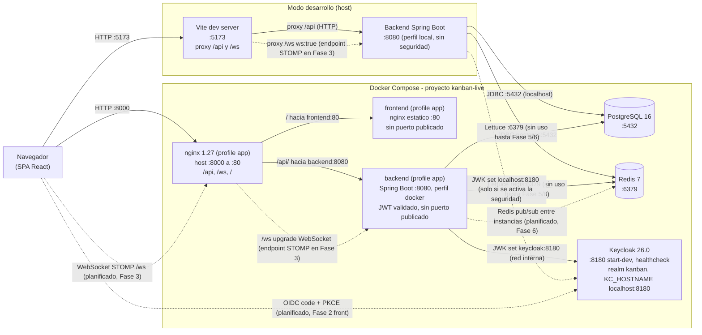
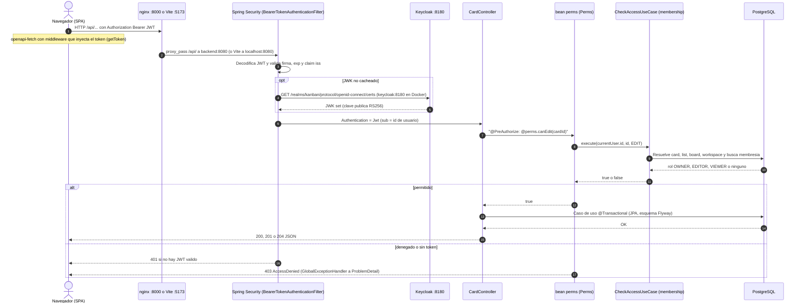
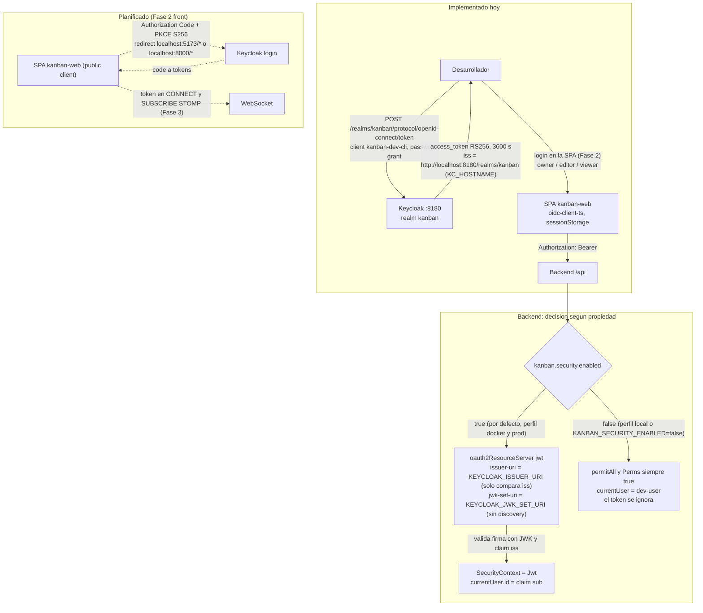
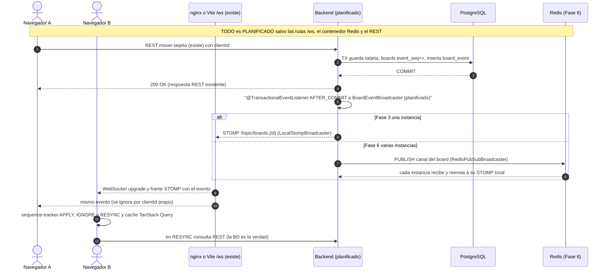
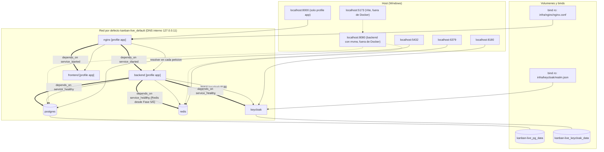

# Diagrama de infraestructura y comunicación de Kanban Live

Documento generado a partir de lo que **existe hoy** en el repo (`infra/docker-compose.yml`, `infra/nginx/nginx.conf`, `infra/keycloak/realm.json`, `backend/src/main/resources/application*.yml`, `SecurityConfig`, `Perms`, `frontend/vite.config.ts`, cliente HTTP del frontend, Dockerfiles y `initial-plan.md`). Actualizado tras los lotes 1-3 de correcciones de infraestructura.

Leyenda: las líneas continuas y los nodos normales están **implementados**; las líneas discontinuas y lo marcado *(planificado)* **no existen aún** en el código.

## 1. Vista general de componentes

Dos modos de acceso: **desarrollo** (Vite en 5173 con proxy `/api` y `/ws` al backend en 8080 con perfil `local`, infra en Docker) y **stack completo** (`--profile app`: backend con perfil `docker`, todo detrás de nginx en el puerto 8000 del host).

Notas:
- `redis` está en compose y `spring-boot-starter-data-redis` / `spring-boot-starter-websocket` están en el `pom.xml`, pero `platform/messaging`, `collaboration/adapter/out/redis` y `presence/adapter/out/redis` solo contienen `package-info.java`: **no hay código de STOMP ni de Redis**.
- Vite y nginx ya proxean `/ws` (Vite con `ws: true`), preparados para el endpoint STOMP de la Fase 3 (B3.1).
- `postgres`, `redis` y `keycloak` arrancan siempre; `backend`, `frontend` y `nginx` solo con `docker compose --profile app up`.
- CORS no es necesario: la SPA siempre llama al mismo origen (proxy de Vite o nginx). Se revisará con STOMP en la Fase 3.

## 2. Flujo de petición REST

Ejemplo con una operación sobre una tarjeta (`@PreAuthorize("@perms.canEdit(#cardId)")` en `CardController`), con seguridad activa (`kanban.security.enabled=true`: valor por defecto, y también en el perfil `docker`).

Rutas públicas incluso con seguridad activa: `/actuator/health/**`, `/actuator/info`, `/v3/api-docs/**`, `/swagger-ui/**` (Swagger solo existe con springdoc habilitado: perfiles `local`, `docker` y `test`). Todo lo demás exige JWT. CSRF está deshabilitado.

Perfil `local` (`kanban.security.enabled=false`): se usa la cadena `openSecurityFilterChain` (`anyRequest().permitAll()`), `Perms` devuelve siempre `true` y `SecurityContextCurrentUser` devuelve `kanban.security.dev-user-id` (por defecto `dev-user`). No hay llamada a Keycloak ni comprobación de membresía. En el perfil `docker` se puede abrir igual con `KANBAN_SECURITY_ENABLED=false`.

## 3. Flujo de autenticación

Detalles del realm `kanban` (`infra/keycloak/realm.json`, importado con `--import-realm`, `sslRequired: none`):
- Clientes: `kanban-web` (público, standard flow + PKCE S256; `rootUrl` `http://localhost:5173`; `redirectUris` y `post.logout.redirect.uris` `http://localhost:5173/*` y `http://localhost:8000/*`; `webOrigins` `http://localhost:5173` y `http://localhost:8000`), `kanban-dev-cli` (público, **solo** password grant para curl/pruebas manuales), `kanban-api` (bearer-only, resource server).
- Usuarios de desarrollo: `owner/owner`, `editor/editor`, `viewer/viewer` con roles de realm `owner|editor|viewer`. Estos roles **no** autorizan nada: la autorización real es la membresía por workspace en BD.
- Issuer vs JWKS: con `KC_HOSTNAME=http://localhost:8180` y `KC_HOSTNAME_BACKCHANNEL_DYNAMIC=true`, todos los tokens llevan `iss=http://localhost:8180/realms/kanban` aunque se pidan por otro host. El backend en Docker compara contra ese issuer (`KEYCLOAK_ISSUER_URI`) y descarga el JWKS por la red interna (`KEYCLOAK_JWK_SET_URI=http://keycloak:8180/...`). Al definir `jwk-set-uri` no hay discovery del issuer en el arranque.
- Los cambios de `realm.json` solo se aplican al reimportar: `docker volume rm kanban-live_keycloak_data` (con keycloak parado) y volver a levantarlo.

## 4. Flujo en tiempo real / eventos

**Estado: planificado (Fase 3 una instancia, Fase 6 escalado con Redis). No hay código.** Solo existen las dependencias del `pom.xml`, los `package-info.java` vacíos, el contenedor Redis y la ruta `/ws` en nginx y en el proxy de Vite.

Reglas del plan que aplican: permisos también en `CONNECT`/`SUBSCRIBE`, eventos solo tras commit, el WS solo notifica. Presencia (`presence/adapter/out/redis`) y colaboración (`collaboration/adapter/out/redis`) también son paquetes vacíos.

## 5. Red Docker, dependencias de arranque, volúmenes y variables

Orden de arranque con `--profile app`: `postgres` y `redis` (healthcheck cada 5 s, 10 reintentos) y `keycloak` (healthcheck `GET /health/ready` en el puerto de management 9000 vía `bash /dev/tcp`, porque la imagen no trae curl; cada 10 s, 30 reintentos, `start_period` 30 s) y luego `backend`; `nginx` espera a que `backend` y `frontend` hayan arrancado. El backend ejecuta Flyway al arrancar (`ddl-auto: validate`).

Imágenes: `backend/Dockerfile` (build `eclipse-temurin:21-jdk`, runtime `21-jre`, `EXPOSE 8080`); `frontend/Dockerfile` (build `node:22-alpine`, runtime `nginx:1.27-alpine` con fallback SPA `try_files $uri /index.html`, `EXPOSE 80`).

### Tabla de puertos

| Servicio | Puerto host | Puerto contenedor | Protocolo | Perfil compose |
|---|---|---|---|---|
| nginx (proxy inverso) | 8000 | 80 | HTTP (upgrade WS en `/ws`) | `app` |
| PostgreSQL 16 | 5432 | 5432 | TCP (JDBC) | siempre |
| Redis 7 | 6379 | 6379 | TCP (RESP) | siempre |
| Keycloak 26.0 | 8180 | 8180 (`KC_HTTP_PORT`), 9000 management (sin publicar) | HTTP | siempre |
| backend | no publicado | 8080 | HTTP | `app` |
| frontend (nginx estático) | no publicado | 80 | HTTP | `app` |
| Vite dev server | 5173 | n/a | HTTP (proxy `/api`, `/ws`) | fuera de Docker |
| backend con `mvnw spring-boot:run` | 8080 | n/a | HTTP | fuera de Docker |

### Tabla de variables y propiedades por perfil

| Variable / propiedad | Dónde | Valor | Aplica a |
|---|---|---|---|
| `SPRING_PROFILES_ACTIVE` | compose backend | `docker` | stack `app` (`application-docker.yml`) |
| `SPRING_DATASOURCE_URL/USERNAME/PASSWORD` | compose backend | `jdbc:postgresql://postgres:5432/kanban`, `kanban`, `kanban` | stack `app` |
| `spring.datasource.*` | `application-local.yml` | `jdbc:postgresql://localhost:5432/kanban`, `kanban/kanban` | local |
| datasource | Testcontainers `@ServiceConnection` (`PostgresIT`) | dinámico | test |
| `SPRING_DATA_REDIS_HOST/PORT`, `spring.data.redis.host/port` | compose / `application-local.yml` / `application-test.yml` | `redis:6379` / `localhost:6379` / `localhost:6379` | app, local, test |
| `management.health.redis.enabled` | `application-test.yml` | `false` | test |
| `KEYCLOAK_ISSUER_URI` | `application.yml` (por defecto `http://localhost:8180/realms/kanban`); compose backend | `http://localhost:8180/realms/kanban` (igual al `iss` fijado por `KC_HOSTNAME`) | todos |
| `KEYCLOAK_JWK_SET_URI` | `application.yml` (por defecto `http://localhost:8180/realms/kanban/protocol/openid-connect/certs`); compose backend | `http://keycloak:8180/realms/kanban/protocol/openid-connect/certs` (red interna) | todos |
| `kanban.security.enabled` | ausente en `application.yml` (= `true`); `false` en `application-local.yml`; `${KANBAN_SECURITY_ENABLED:true}` en `application-docker.yml` | boolean | `false` solo en local; `true` en docker, prod y por defecto |
| `KANBAN_SECURITY_ENABLED` | compose backend | `${KANBAN_SECURITY_ENABLED:-true}` | stack `app` (`false` abre la API) |
| `kanban.security.dev-user-id` | `SecurityContextCurrentUser` | por defecto `dev-user` | solo con seguridad desactivada |
| `springdoc.api-docs/swagger-ui.enabled` | `application.yml` `false`; `local`, `docker` y `test` `true` | boolean | habilitado en local, docker y test |
| `management.endpoints.web.exposure.include` | `application.yml` | `health,info` | todos |
| `VITE_API_BASE_URL` | `frontend/.env.example` | vacío = mismo origen | dev y build (en prod, nginx `/api`) |
| `VITE_OIDC_AUTHORITY` | `frontend/.env.example` | `http://localhost:8180/realms/kanban` | SPA (login OIDC) |
| `VITE_OIDC_CLIENT_ID` | `frontend/.env.example` | `kanban-web` | SPA (cliente público PKCE) |
| `VITE_OIDC_REDIRECT_URI` / `VITE_OIDC_POST_LOGOUT_REDIRECT_URI` | `frontend/.env.example` | `<origen>/auth/callback` / `<origen>/auth/signed-out` | SPA; deben coincidir con `redirectUris` / `post.logout.redirect.uris` del cliente `kanban-web` |
| `POSTGRES_DB/USER/PASSWORD` | compose | `kanban/kanban/kanban` | contenedor postgres |
| `KC_BOOTSTRAP_ADMIN_USERNAME/PASSWORD` | compose | `${KC_ADMIN_USER:-admin}` / `${KC_ADMIN_PASSWORD:-admin}` (solo desarrollo) | contenedor keycloak |
| `KC_HTTP_PORT`, `KC_HEALTH_ENABLED` | compose | `8180`, `true` | contenedor keycloak |
| `KC_HOSTNAME`, `KC_HOSTNAME_BACKCHANNEL_DYNAMIC` | compose | `http://localhost:8180`, `true` | contenedor keycloak (issuer fijo, backchannel interno) |

Perfil **prod**: no existe `application-prod.yml`; el comportamiento "prod" es el `application.yml` base (seguridad activa, springdoc apagado) con `KEYCLOAK_*` y datasource inyectados por entorno.

## 6. Inconsistencias de infraestructura: estado

### Corregidas (lotes 1-3)

1. **Stack `app` con seguridad desactivada**: el backend en Docker usa ahora el perfil `docker` (`application-docker.yml`), con JWT validado por defecto; `KANBAN_SECURITY_ENABLED=false` lo abre explícitamente.
2. **Issuer/JWK mezclados en compose**: `KC_HOSTNAME=http://localhost:8180` + `KC_HOSTNAME_BACKCHANNEL_DYNAMIC=true` fijan `iss=http://localhost:8180/realms/kanban`; el backend compara con ese issuer y descarga el JWKS por `keycloak:8180`. Verificado: 401 sin token, 200 con token de `kanban-dev-cli`.
3. **Nombres de variable distintos**: compose usa ya `KEYCLOAK_ISSUER_URI`/`KEYCLOAK_JWK_SET_URI`, los mismos que lee `application.yml`.
4. **Redirect URIs de Keycloak**: `kanban-web` admite también `http://localhost:8000/*` (redirect y post-logout) y `http://localhost:8000` (webOrigins).
5. **`/ws` en Vite**: el proxy de Vite cubre `/ws` (`ws: true`), igual que nginx. El endpoint STOMP sigue pendiente (ver abajo).
6. **`depends_on` de Keycloak**: keycloak tiene healthcheck (`/health/ready` en el puerto 9000) y el backend espera `service_healthy`.
7. **nginx siempre arrancaba**: nginx está ahora en el perfil `app` y depende de `backend` y `frontend`.
8. **Credenciales admin fijas**: parametrizadas con `KC_ADMIN_USER`/`KC_ADMIN_PASSWORD` (por defecto `admin/admin`, solo desarrollo).
9. **Puertos del front**: el realm acepta tanto Vite (5173) como el stack Docker (8000).
10. **CORS**: documentado como no necesario (mismo origen vía proxy Vite/nginx) en `platform/web/package-info.java`; no se añade `CorsConfig`.

### Pendientes (diferidas por fase)

1. **Endpoint STOMP `/ws` y CORS/orígenes del WebSocket** (Fase 3, B3.1): las rutas `/ws` de nginx y Vite no tienen destino hasta entonces; al añadir STOMP se revisarán los orígenes permitidos.
2. **Redis sin uso** (Fase 5/6): contenedor, dependencia y `depends_on` existen sin código que lo use; el backend en `app` espera `redis` healthy sin necesitarlo todavía.
3. **Producción** (Fase 7): no existe `application-prod.yml`, y Keycloak sigue en `start-dev` con BD embebida en el volumen `kanban-live_keycloak_data` y `sslRequired: none`; hace falta modo `start` con BD externa, TLS y credenciales reales.
