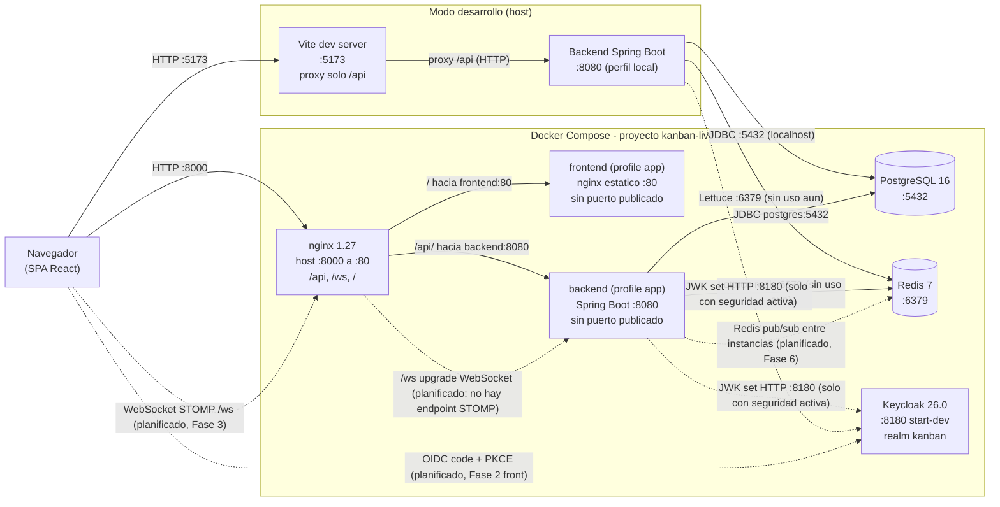
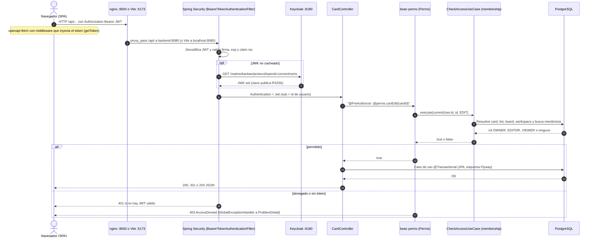
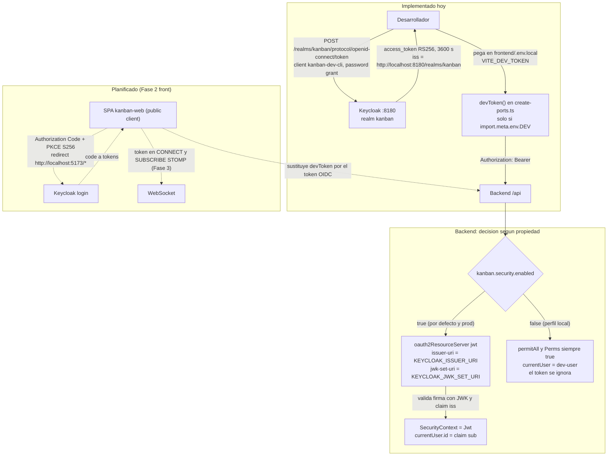
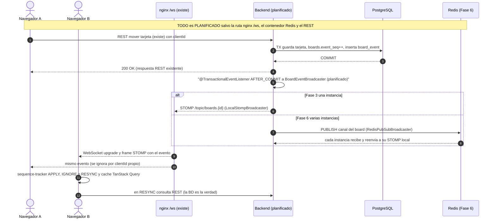
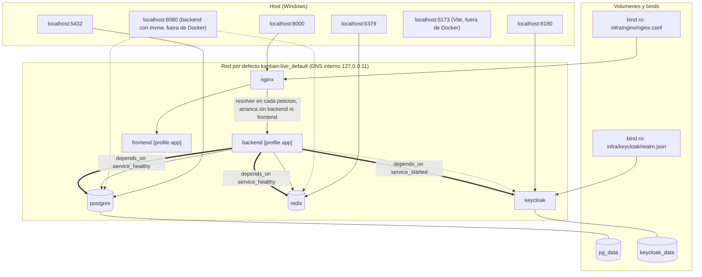

# Diagrama de infraestructura y comunicación de Kanban Live

Documento generado a partir de lo que **existe hoy** en el repo (`infra/docker-compose.yml`, `infra/nginx/nginx.conf`, `infra/keycloak/realm.json`, `backend/src/main/resources/application*.yml`, `SecurityConfig`, `Perms`, `frontend/vite.config.ts`, cliente HTTP del frontend, Dockerfiles y `initial-plan.md`).

Leyenda: las líneas continuas y los nodos normales están **implementados**; las líneas discontinuas y lo marcado *(planificado)* **no existen aún** en el código.

## 1. Vista general de componentes

Dos modos de acceso: **desarrollo** (Vite en 5173 con proxy `/api` al backend en 8080, infra en Docker) y **stack completo** (`--profile app`, todo detrás de nginx en el puerto 8000 del host).

Notas:
- `redis` está en compose y `spring-boot-starter-data-redis` / `spring-boot-starter-websocket` están en el `pom.xml`, pero `platform/messaging`, `collaboration/adapter/out/redis` y `presence/adapter/out/redis` solo contienen `package-info.java`: **no hay código de STOMP ni de Redis**.
- Vite **no** proxea `/ws` (solo `/api`).
- `postgres`, `redis`, `keycloak` y `nginx` arrancan siempre; `backend` y `frontend` solo con `docker compose --profile app up`.

## 2. Flujo de petición REST

Ejemplo con una operación sobre una tarjeta (`@PreAuthorize("@perms.canEdit(#cardId)")` en `CardController`), con seguridad activa (`kanban.security.enabled=true`, valor por defecto).

Rutas públicas incluso con seguridad activa: `/actuator/health/**`, `/actuator/info`, `/v3/api-docs/**`, `/swagger-ui/**` (Swagger solo existe con springdoc habilitado: perfiles `local` y `test`). Todo lo demás exige JWT. CSRF está deshabilitado.

Modo local (`kanban.security.enabled=false`): se usa la cadena `openSecurityFilterChain` (`anyRequest().permitAll()`), `Perms` devuelve siempre `true` y `SecurityContextCurrentUser` devuelve `kanban.security.dev-user-id` (por defecto `dev-user`). No hay llamada a Keycloak ni comprobación de membresía.

## 3. Flujo de autenticación

Detalles del realm `kanban` (`infra/keycloak/realm.json`, importado con `--import-realm`, `sslRequired: none`):
- Clientes: `kanban-web` (público, standard flow + PKCE S256, redirect y webOrigins `http://localhost:5173`), `kanban-dev-cli` (público, **solo** password grant para curl/pruebas manuales), `kanban-api` (bearer-only, resource server).
- Usuarios de desarrollo: `owner/owner`, `editor/editor`, `viewer/viewer` con roles de realm `owner|editor|viewer`. Estos roles **no** autorizan nada: la autorización real es la membresía por workspace en BD.
- El `iss` del token debe coincidir exactamente con `issuer-uri`; por eso importa el host usado para pedir el token (`localhost:8180` vs `keycloak:8180`).

## 4. Flujo en tiempo real / eventos

**Estado: planificado (Fase 3 una instancia, Fase 6 escalado con Redis). No hay código.** Solo existen las dependencias del `pom.xml`, los `package-info.java` vacíos, el contenedor Redis y la ruta `/ws` en nginx.

Reglas del plan que aplican: permisos también en `CONNECT`/`SUBSCRIBE`, eventos solo tras commit, el WS solo notifica. Presencia (`presence/adapter/out/redis`) y colaboración (`collaboration/adapter/out/redis`) también son paquetes vacíos.

## 5. Red Docker, dependencias de arranque, volúmenes y variables

Orden de arranque con `--profile app`: `postgres` y `redis` (healthcheck cada 5 s, 10 reintentos) y `keycloak` (solo `started`, sin healthcheck propio aunque `KC_HEALTH_ENABLED=true`) y luego `backend`. `frontend` y `nginx` no tienen `depends_on`. El backend ejecuta Flyway al arrancar (`ddl-auto: validate`).

Imágenes: `backend/Dockerfile` (build `eclipse-temurin:21-jdk`, runtime `21-jre`, `EXPOSE 8080`); `frontend/Dockerfile` (build `node:22-alpine`, runtime `nginx:1.27-alpine` con fallback SPA `try_files $uri /index.html`, `EXPOSE 80`).

### Tabla de puertos

| Servicio | Puerto host | Puerto contenedor | Protocolo | Perfil compose |
|---|---|---|---|---|
| nginx (proxy inverso) | 8000 | 80 | HTTP (upgrade WS en `/ws`) | siempre |
| PostgreSQL 16 | 5432 | 5432 | TCP (JDBC) | siempre |
| Redis 7 | 6379 | 6379 | TCP (RESP) | siempre |
| Keycloak 26.0 | 8180 | 8180 (`KC_HTTP_PORT`) | HTTP | siempre |
| backend | no publicado | 8080 | HTTP | `app` |
| frontend (nginx estático) | no publicado | 80 | HTTP | `app` |
| Vite dev server | 5173 | n/a | HTTP | fuera de Docker |
| backend con `mvnw spring-boot:run` | 8080 | n/a | HTTP | fuera de Docker |

### Tabla de variables y propiedades por perfil

| Variable / propiedad | Dónde | Valor | Aplica a |
|---|---|---|---|
| `SPRING_PROFILES_ACTIVE` | compose backend | `local` | stack `app` (usa perfil local, ver inconsistencias) |
| `SPRING_DATASOURCE_URL/USERNAME/PASSWORD` | compose backend | `jdbc:postgresql://postgres:5432/kanban`, `kanban`, `kanban` | stack `app` (sobreescribe `application-local.yml`) |
| `spring.datasource.*` | `application-local.yml` | `jdbc:postgresql://localhost:5432/kanban`, `kanban/kanban` | local |
| datasource | Testcontainers `@ServiceConnection` (`PostgresIT`) | dinámico | test |
| `SPRING_DATA_REDIS_HOST`, `spring.data.redis.host/port` | compose / `application-local.yml` / `application-test.yml` | `redis` / `localhost:6379` / `localhost:6379` | app, local, test |
| `management.health.redis.enabled` | `application-test.yml` | `false` | test |
| `SPRING_SECURITY_OAUTH2_RESOURCESERVER_JWT_ISSUER_URI` | compose backend | `http://keycloak:8180/realms/kanban` | stack `app` |
| `KEYCLOAK_ISSUER_URI` | `application.yml` | por defecto `http://localhost:8180/realms/kanban` | base (test, prod; override por entorno) |
| `KEYCLOAK_JWK_SET_URI` | `application.yml` | por defecto `http://localhost:8180/realms/kanban/protocol/openid-connect/certs` | base (test, prod) |
| `kanban.security.enabled` | ausente en `application.yml` (= `true`); `false` en `application-local.yml` | boolean | `false` solo en local; `true` en prod y por defecto |
| `kanban.security.dev-user-id` | `SecurityContextCurrentUser` | por defecto `dev-user` | solo con seguridad desactivada |
| `springdoc.api-docs/swagger-ui.enabled` | `application.yml` `false`; `local` y `test` `true` | boolean | habilitado en local y test |
| `management.endpoints.web.exposure.include` | `application.yml` | `health,info` | todos |
| `VITE_API_BASE_URL` | `frontend/.env.example` | vacío = mismo origen | dev y build (en prod, nginx `/api`) |
| `VITE_DEV_TOKEN` | `frontend/.env.local` (ignorado por git) | JWT de `kanban-dev-cli` | solo `import.meta.env.DEV`; nunca en `vite build` |
| `POSTGRES_DB/USER/PASSWORD` | compose | `kanban/kanban/kanban` | contenedor postgres |
| `KC_BOOTSTRAP_ADMIN_USERNAME/PASSWORD`, `KC_HTTP_PORT`, `KC_HEALTH_ENABLED` | compose | `admin/admin`, `8180`, `true` | contenedor keycloak |

Perfil **prod**: no existe `application-prod.yml`; el comportamiento "prod" es el `application.yml` base (seguridad activa, springdoc apagado) con `KEYCLOAK_*` y datasource inyectados por entorno.

## 6. Inconsistencias detectadas en la infraestructura

1. **Stack `app` con seguridad desactivada**: compose fija `SPRING_PROFILES_ACTIVE=local`, que pone `kanban.security.enabled=false`. Aunque se define el issuer de Keycloak, el backend en Docker acepta todo sin JWT.
2. **Issuer/JWK mezclados en compose**: se sobreescribe el issuer con `http://keycloak:8180/...`, pero no `jwk-set-uri`, que sigue en `localhost:8180` (dentro del contenedor no es Keycloak). Además, un token pedido en `localhost:8180` lleva `iss=http://localhost:8180/...` y no coincidiría con `keycloak:8180`. Si se activa la seguridad en Docker fallaría la validación (hace falta `KC_HOSTNAME` o unificar issuer).
3. **Nombres de variable distintos**: `application.yml` usa `KEYCLOAK_ISSUER_URI`/`KEYCLOAK_JWK_SET_URI`; compose usa el binding relajado `SPRING_SECURITY_OAUTH2_...`. Funcionan ambos, pero conviene unificar.
4. **Redirect URIs de Keycloak**: `kanban-web` solo permite `http://localhost:5173/*`; con el stack completo la SPA se sirve en `http://localhost:8000`, que no está en `redirectUris`/`webOrigins`.
5. **`/ws` sin destino**: nginx proxea `/ws` y la dependencia `starter-websocket` está en el `pom.xml`, pero no hay endpoint STOMP; el proxy de Vite tampoco cubre `/ws`.
6. **Redis sin uso**: contenedor, dependencia y `depends_on` existen, pero no hay código que lo use (el backend en `app` espera `redis` healthy sin necesitarlo).
7. **`depends_on` de Keycloak**: solo `service_started` pese a `KC_HEALTH_ENABLED`; no hay healthcheck (hoy irrelevante por el JWK perezoso).
8. **Keycloak en `start-dev`** con BD embebida en el volumen `keycloak_data` y credenciales `admin/admin`: solo desarrollo.
9. **nginx siempre arranca**: sin el perfil `app` devuelve 502 para `/` y `/api`.
10. **CORS**: `platform/web/package-info.java` lo menciona pero no hay configuración; funciona por mismo origen (proxy Vite / nginx) y fallaría si la SPA llamara a otro origen directamente.
11. **Puertos del front**: el realm asume la SPA en 5173 (Vite), mientras el stack Docker expone 8000; no hay entorno documentado que alinee ambos.
